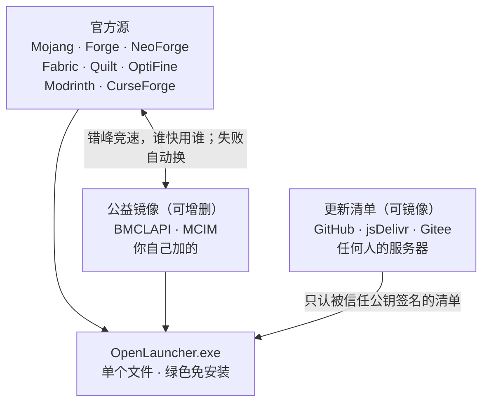

<p align="center"></p>

<h1 align="center">OpenLauncher</h1>

<p align="center">去中心化的 Minecraft 启动器 · 没有服务器 · 单个 exe · 绿色免安装</p>

<p align="center">
  <a href="LICENSE"></a>
  
  
  <a href="https://github.com/VeblenQuinn/OpenLauncher/releases"></a>
</p>

---

**我们不包更新，但保证你不需要我们也能一直用、一直更新。**

- 游戏、加载器、Mod 全部直接从官方源和公益镜像下载，版本列表实时获取，启动器不内置任何版本号。
- 启动器自己的更新走**签名清单**：任何人都能镜像分发，只有签名对得上才会安装；维护者失联时社区可以换钥匙接手。
- 不收集任何数据。账号令牌用 Windows DPAPI 加密，只存在你这台电脑上。

## 下载使用

从 [Releases](https://github.com/VeblenQuinn/OpenLauncher/releases) 下载 **`OpenLauncher.exe` 和 `OpenLauncher.exe.config`**，两个一起放进一个空文件夹，双击 exe 即可。

> `OpenLauncher.exe.config` 不能漏。少了它，在 .NET Framework 低于 4.8 的旧系统上不会提示安装运行库，而是直接崩溃。

游戏文件默认放在 exe 旁边的 `.minecraft`，启动器配置在 `OpenLauncher` 文件夹里——**整个文件夹拷走就能在别的电脑上用**，没有注册表、没有 AppData 残留。

已经在用官方启动器、PCL 或 HMCL 的话，不必重新下载游戏：在 **版本选择 → 添加已有的游戏目录** 里指向那个 `.minecraft` 就行。

### 系统要求

| 项目 | 要求 |
|---|---|
| 系统 | Windows 10 1903（2019 年 5 月更新）或更新、Windows 11 |
| 运行库 | .NET Framework 4.8 —— 上面这些系统**自带**，无需安装 |
| 权限 | 无需管理员权限 |
| Java | 不用自己装。启动器会扫描已装的 Java，缺合适的版本时自动下载 |

Windows 7 / 8.1 / 更早的 Win10 需要自行安装 [.NET Framework 4.8](https://dotnet.microsoft.com/download/dotnet-framework/net48)。

## 功能

### 启动

- 一键启动，自动补全缺失文件，逐个校验
- 自动挑选合适的 Java 版本，缺了就自动下载
- 按系统内存和整合包需要自动分配内存，也可以手动指定
- 版本隔离（每个版本独立 `saves` / `mods` / `config`）
- 自定义窗口标题、初始窗口大小、是否全屏
- 启动后自动进服务器（填地址即可）
- 启动后可选最小化 / 隐藏 / 关闭启动器
- 实时游戏日志面板；一键导出可复现的启动脚本

### 账号

- 离线账号
- 微软正版登录（设备代码流，无需手动开浏览器回调端口；Client ID 可配置）
- 外置登录：authlib-injector，支持 LittleSkin、Blessing Skin 等
- 皮肤与头像，登录一次后缓存，之后启动不再联网拉取

### 下载游戏与加载器

- 正式版、快照、远古版、愚人节版
- Forge、NeoForge、Fabric（可一并装 Fabric API）、Quilt、OptiFine
- 自己执行 Forge 安装器的处理器，而不是依赖它自带的下载器
- 下载可走镜像，可选是否校验每个文件

### 社区资源

- Modrinth + CurseForge 双源搜索，结果合并去重
- Mod、整合包、资源包、光影包、数据包
- 常见中文名搜索（内置中文名表）
- 按游戏版本和加载器筛选
- **自动识别前置 Mod**，安装时列出并询问是否一并下载
- 详情页直接标出「已安装 / 有更新」，不用自己比对文件名

### 整合包

- 导入 Modrinth `.mrpack`
- 导入 CurseForge `.zip`
- 导出为 `.mrpack`

### 版本与文件管理

- 多个 `.minecraft` 目录并存，随时切换
- 版本重命名、加描述、删除（进回收站，不是直接抹掉）
- Mod 启用 / 禁用、批量检查更新、一键更新
- 资源包、光影、存档、截图管理，支持拖放安装
- 长路径支持（整合包里超过 260 字符的路径也能正常装）

### 种子地图

内嵌 [cubiomes](https://github.com/Cubitect/cubiomes) 引擎，选好版本和种子即可离线渲染生物群系地图，与游戏内生成结果逐位一致。

- 支持主世界、下界、末地
- 地图上标出村庄、要塞、远古城市、试炼密室、海底神殿等结构，可点击跳转坐标
- 悬停显示群系名；文本种子按 Java `hashCode` 规则处理
- 引擎编译进 exe，不需要联网，也不需要装任何东西

### 崩溃分析

启动失败或游戏崩溃时读日志，识别常见原因并给出可操作的建议：

内存不足、Java 版本不匹配、缺前置 Mod、Mod 重复、Mixin 冲突、显卡驱动过旧、Mod 与游戏版本不符……

认不出来也不会只丢一个「启动失败」——原始日志照样能看、能一键导出成错误报告。

### 下载与网络

- 多线程下载，断点续传，失败自动换源
- BMCLAPI / MCIM 镜像与官方源**错峰竞速**，谁快用谁，连不上的源自动拉黑
- 镜像地址可自定义
- 可限速

### 外观

- 主题色
- 浅色 / 深色 / 跟随系统
- 背景图

### 更新

- 多个更新源并行拉取签名清单，取版本最高的有效清单
- 可手动添加信任的发布者公钥
- 镜像表可随签名清单一起下发，无需重装

## 工作原理



三处设计让它不依赖任何一个服务器：

1. **游戏资源**：任何一份能连上的镜像都够用，也可以自己搭。
2. **启动器更新**：清单是纯文件，谁都能镜像。签名对不上就不装，所以镜像方无法投毒。
3. **换维护者**：改名、换仓库、换钥匙，只需要改 `src/OpenLauncher/Branding.cs` 一个文件，代码一行不用动。

## 项目结构

```
src/OpenLauncher/
  Core/        JSON、HTTP、镜像表、多线程下载器、设置、任务
  Game/        版本 JSON 合并、安装器（原版 / Fabric / Quilt / Forge / NeoForge / OptiFine）、
               启动参数、Java 管理、崩溃分析
  Accounts/    离线 / 微软 / 外置登录、authlib-injector、皮肤
  Content/     Modrinth / CurseForge、已装资源识别、本地 Mod 管理、整合包导入导出
  SeedMap/     种子地图（嵌入 cubiomes 引擎）
  Update/      签名清单与自更新
  UI/          WPF 界面
tools/Release/ 发布工具：生成密钥、签名清单、校验
tools/         构建 cubiomes 引擎、生成图标
```

## 自己编译

只需要 [.NET SDK](https://dotnet.microsoft.com/download)（8 或更新），不需要 Visual Studio：

```powershell
.\build.ps1        # 产物在 dist\OpenLauncher.exe
```

也可以在 VS Code 里按 `Ctrl+Shift+B`，用 `.vscode/tasks.json` 里的任务。

## 发版

<details>
<summary>维护者专用：签名与发布流程</summary>

发布需要一对 RSA 密钥。**私钥自己留着，绝不进仓库**；公钥随程序分发。

```powershell
# 1) 首次生成密钥（之后一直复用；丢了就只能换钥匙重发）
dotnet build .\tools\Release\OpenLauncher.Release.csproj -c Release
.\tools\Release\bin\Release\ol-release.exe keygen D:\keys
.\tools\Release\bin\Release\ol-release.exe fingerprint D:\keys\public-key.xml

# 2) 编译 + 签名更新清单
.\publish.ps1 -Version 0.1.45 -Key D:\keys\private-key.xml -Pub D:\keys\public-key.xml -Urls "https://github.com/用户名/仓库/releases/download/v0.1.45/OpenLauncher.exe"
```

`publish.ps1` 会改 `OpenLauncher.csproj` 的版本号、跑 `build.ps1`、生成并校验 `release\update.json`。

接着：

1. 在 GitHub 建 Release，tag 必须与 `-Version` 一致
2. 上传 `dist\OpenLauncher.exe` **和** `dist\OpenLauncher.exe.config`
3. 提交 `release/update.json` 和改过版本号的 `OpenLauncher.csproj`

可选参数：`-Notes release\notes.md` 附带发版说明，`-Config release\config.json` 随清单下发镜像表 / 更新源 / 中文词表。

**钥匙轮换**：新私钥签名时加 `--add-key <新公钥.xml>`；旧密钥泄露用 `--revoke <指纹>`。注意老版本启动器只认自己被分发的那把公钥，所以换钥匙后用户需要手动信任新公钥（设置 → 更新）。

**微软登录**要自备 Azure Client ID，填在 设置 → 账户 里。

</details>

## 反馈与参与

- 遇到 bug 或有功能建议：开 [Issue](https://github.com/VeblenQuinn/OpenLauncher/issues)，崩溃的话附上「崩溃分析」里导出的错误报告
- 想改代码：欢迎 PR。提交前请先开 Issue 说一下方向，避免白做
- 发现安全漏洞：**不要公开开 Issue**，见 [SECURITY.md](SECURITY.md)

## 许可证

Copyright (C) 2026 OpenLauncher contributors

本项目以 **GNU 通用公共许可证第 3 版（GPL-3.0-only）** 发布，全文见 [LICENSE](LICENSE)。第三方组件的许可见 [THIRD-PARTY-NOTICES.md](THIRD-PARTY-NOTICES.md)。

- **可以**自由使用、修改、分发，包括商用。
- **必须**：分发时一并提供完整源码（或指向本仓库的明确获取方式）；保留版权声明与许可证；修改过的文件注明「已修改」；衍生作品同样以 **GPL-3.0-only** 授权——不能换成 GPL-4，也不能改成「或更新版本」。
- **不能**：把本项目（或其衍生品）改成闭源专有软件再分发。

本程序是「用户程序」，因此 GPL-3.0 §6「随程序提供安装信息」的要求同样适用：分发编译好的 exe 时，请同时提供本仓库地址，或把 `src/` 一并附上。
